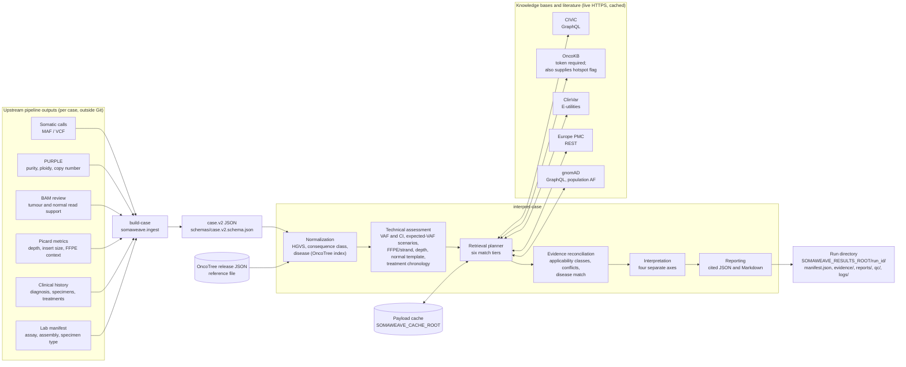
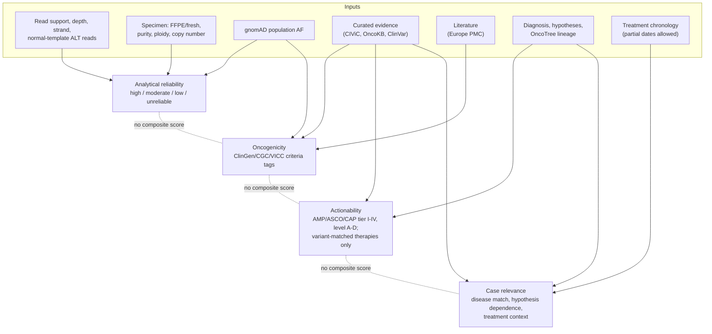

# SomaWeave

**Evidence-grounded somatic cancer genomics interpretation.**

SomaWeave is a research platform that combines somatic genomic findings, specimen and sequencing evidence, clinical history, curated cancer knowledge bases and scientific literature into traceable research interpretations.

**Status:** early development (v0.1). The command-line workflow validates a case, normalizes it, performs deterministic technical assessment, retrieves evidence from CIViC, OncoKB (licensed token), ClinVar, Europe PMC and gnomAD, reconciles and interprets it along four separate axes, and writes a cited JSON and Markdown research report. Research use only; not for standalone clinical decision-making.

## How it works

### Data sources and data flow



Every query result is recorded with its source, tier, status and timestamp. A source that is unreachable, unlicensed or returns nothing is recorded as `missing`/`no_records`/`no_credentials`, never as negative evidence. `--offline` runs the whole engine with every source marked `not_queried`.

### Retrieval tiers

The planner walks the tiers from most to least specific and tags every record with the tier that produced it: `exact_variant` → `codon` → `functional_equivalent` → `gene_alteration_class` → `gene` → `pathway`. Reconciliation then assigns each record an applicability class (exact, codon, truncating/loss/splice/functional class, region, gene-wide, fusion, expression, copy number, …) that decides whether it may tier a small variant or is kept as gene-level context only.

### What feeds each interpretation axis



The four labels are reported side by side and never combined. Clonality and LOH are never inferred from VAF alone; the technical layer lists the copy-number/purity scenarios compatible with the observed VAF instead. Cross-cancer evidence is labelled as such and capped at Tier III.

### Candidate tools: what was adopted and what was not

| Resource | Status in SomaWeave | Role |
|---|---|---|
| CIViC | **Adopted** — `providers/civic.py` | Predictive / prognostic / diagnostic evidence items and assertions with levels, disease (DOID) and drugs |
| OncoKB | **Adopted** — `providers/oncokb.py` (institutional academic token, outside Git) | Oncogenicity, therapeutic levels, hotspot flag; class-level evidence for truncating variants |
| ClinVar | **Adopted** — `providers/clinvar.py` | Germline/somatic classifications with review status and conditions, quoted not re-derived |
| Europe PMC | **Adopted** — `providers/europepmc.py` | Literature retrieval and citation validation |
| gnomAD | **Adopted** — `providers/gnomad.py` | Population allele frequency as an analytical/oncogenicity caution |
| OncoTree | **Adopted** — `normalization/disease.py` (versioned release JSON as a reference file) | Disease code, name, synonym and lineage resolution |
| cancerhotspots.org | Not integrated | Hotspot flag taken from OncoKB instead; no duplicated hotspot source |
| cBioPortal | Assessed, optional later | Cohort frequency context only; never an actionability source |
| Molecular Oncology Almanac | Assessed, optional later | Would consume the database JSON directly, not the algorithm package |
| BioMCP | Assessed, not adopted | MCP wrapper over sources already queried directly; candidate benchmark comparator only |
| ToolUniverse | Assessed, not adopted | Candidate benchmark comparator only |
| PCGR | Assessed, comparator only | Design in `docs/BENCHMARK_COMPARATORS_DESIGN.md`; an Apptainer image exists on the HPC but no comparison has been run |
| Djerba / report templates | Out of scope | Downstream reporting integration not started |

Details and licence notes: [docs/PHASE0_ASSESSMENT.md](docs/PHASE0_ASSESSMENT.md), [docs/POPULATION_HOTSPOTS.md](docs/POPULATION_HOTSPOTS.md), [docs/INGESTION.md](docs/INGESTION.md), [docs/BENCHMARK.md](docs/BENCHMARK.md).

## Principles

- Keep analytical validity, oncogenicity, actionability and case relevance separate; no composite score.
- Preserve the original source, evidence level, timestamp and uncertainty behind every claim.
- A failed or skipped query is missing evidence, never negative evidence.
- Never infer clonality or LOH from VAF alone; report compatible scenarios instead.
- Support longitudinal specimens and treatment chronology.
- Keep clinical data, sequencing files, credentials and generated reports outside source control.
- Make local and HPC execution reproducible and portable.

## Start here

Read **[docs/REPOSITORY_CONTRACT.md](docs/REPOSITORY_CONTRACT.md)** before modifying the project. It is the binding directory placement and integration contract.

```bash
conda env create -f hpc/env/somaweave.yaml
conda activate somaweave
python -m pip install -e .

python -m somaweave build-case --help                                      # upstream files -> case.v2 JSON
python -m somaweave validate-case examples/synthetic_case.json
export SOMAWEAVE_RESULTS_ROOT=/path/outside/the/repo
python -m somaweave interpret-case examples/synthetic_case.json --offline
python -m somaweave interpret-case examples/synthetic_case.json          # live retrieval
python -m somaweave interpret-case --help                                # roots, cache, providers config, OncoTree

python -m unittest discover -s tests -v
python scripts/check_structure.py
python scripts/export_schemas.py --check
```

## Layout

- `src/somaweave/` — Python implementation: `domain`, `ingest`, `normalization`, `technical`, `providers`, `retrieval`, `evidence`, `interpretation`, `reporting`, `workflows`, `cli.py`.
- `schemas/` — versioned JSON Schemas generated from the domain models (`case.v1`, `case.v2`, `evidence.v1`).
- `configs/` — portable, secret-free configuration examples (provider endpoints, rate limits).
- `examples/` — synthetic cases only.
- `tests/` — unit, contract and end-to-end tests with recorded offline fixtures.
- `hpc/` — conda environment spec, Slurm templates and cluster notes.
- `scripts/` — repository QA (`check_structure.py`, `export_schemas.py`) and the synthetic benchmark runner (`run_benchmark.py`).
- `docs/` — specification, architecture, contract, HPC guidance, development rules, roadmap, Phase 0 assessment.

See [architecture](docs/ARCHITECTURE.md), [HPC guidance](docs/HPC.md), [development rules](docs/DEVELOPMENT.md), [roadmap](docs/ROADMAP.md) and the [Phase 0 dependency assessment](docs/PHASE0_ASSESSMENT.md).

## Scope

The workflow covers case and variant normalization, technical QC, retrieval of curated and literature evidence, claim reconciliation, rule-constrained interpretation and structured research reporting. External services are optional adapters behind a stable interface and never become silent mandatory dependencies.

## Licensing

No license is granted by this repository yet. External databases and software remain governed by their respective terms (see `docs/PHASE0_ASSESSMENT.md`).
